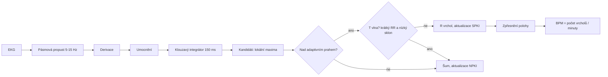
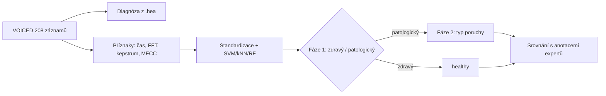

# KI/PZS – seminární práce I a II

Autoři: Jakub Jančařík, Matěj Bureš, Robert Thomas Seaborn

## Instalace

```bash
pip install -r requirements.txt
```

## Spuštění

**Doporučený postup:** data nejdřív stáhnout a skripty spouštět s `--data-dir data`.
Bez `--data-dir` se data streamují přímo z PhysioNetu, což kvůli latenci serveru trvá hodiny.

```bash
python download.py voiced charisdb nsrdb drivedb   # paralelně; u nsrdb/charisdb jen potřebný začátek
python sem1_task1_heart_rate.py --data-dir data
python sem1_task2_correlation.py --data-dir data
python sem2_voiced_classification.py --data-dir data
```

`download.py` lze kdykoli přerušit a spustit znovu (stažené soubory se přeskočí). U nsrdb stáhne
prvních 35 min a u charisdb 61 min každého záznamu (přes HTTP Range, `--full` stáhne vše).

| Úloha | Příkaz | Výstupy |
|---|---|---|
| I/1 Tepová frekvence | `python sem1_task1_heart_rate.py` | `outputs/sem1_task1/` |
| I/2 Korelace signálů | `python sem1_task2_correlation.py` | `outputs/sem1_task2/` |
| II Klasifikace hlasu | `python sem2_voiced_classification.py` | `outputs/sem2/` |

Užitečné přepínače:

* I/1: `--nsrdb-minutes` (délka testovaného úseku nsrdb, výchozí 30), `--skip-drivedb` (jen validace),
  `--no-clip` (původní detektor bez ořezu artefaktů a zotavení prahu), `--no-exclude` (započítat
  i neanotované úseky nsrdb), `--plot ZÁZNAM` (ladicí graf jednoho záznamu).
  `--no-clip` a `--no-exclude` slouží k reprodukci srovnání „před úpravou“ v protokolu.
* I/2: `--fs` (společná vzorkovací frekvence), `--max-lag` (okno vzájemné korelace, výchozí ±0,5 s).
* II: `--reuse` (znovu nepočítat příznaky), `--folds` (počet foldů).

Výpisy obsahují diakritiku; skripty si samy přepnou výstup na UTF-8, takže fungují i na Windows
při přesměrování do souboru.

Offline test funkčnosti na syntetických datech: `python make_synthetic_data.py` a pak spustit skripty
s `--data-dir synthetic` (viz hlavička souboru). Výsledky na syntetice nejsou pro práci použitelné.

## Struktura

| Soubor | Obsah |
|---|---|
| `physio.py` | čtení dat přes WFDB (jediné místo, kde se WFDB používá) |
| `dsp.py` | vlastní DSP: filtry, FFT spektrum, autokorelace, vzájemná korelace, kepstrum, MFCC |
| `voice_features.py` | příznaky hlasu (F0, jitter, shimmer, HNR, spektrální, CPP, MFCC) |
| `sem1_task1_heart_rate.py` | Pan-Tompkins, validace na nsrdb |
| `sem1_task2_correlation.py` | korelace EKG/ABP/ICP, mapa ABP mezi pacienty |
| `sem2_voiced_classification.py` | kaskádová klasifikace, tabulky, grafy |

## Vývojové diagramy (pro protokol)





## Poznámky k metodice (do textové části)

* **Zákaz WFDB pro zpracování:** WFDB čte jen data a anotace. Filtry používají `scipy.signal`
  (Butterworth), FFT `scipy.fft`; detektor, korelace, příznaky a MFCC jsou implementované ručně.
  Klasifikátory jsou ze `scikit-learn` – ověřte u vyučujícího, že je to povoleno.
* **Pan-Tompkins:** vzorkovací frekvence se bere z hlavičky (drivedb má EKG na 496 Hz při základní frekvenci
  hlavičky 15,5 Hz – řeší `physio.read_signal`).
* **Tolerance validace:** detekce se považuje za správnou do ±100 ms od anotace (`--tolerance-ms`).
* **Tepová frekvence po minutách:** `drivedb_tepy_po_minutach.csv` a graf
  `drivedb_tepova_frekvence_po_minutach.png` (počet R vrcholů v každé celé minutě, jak to definuje zadání).
* **charisdb:** skript vypisuje původní fs a podíl chybějících vzorků každého kanálu
  (`kvalita_vzorkovani_chybejici_data.csv`).
* **Korelace ABP mezi pacienty:** celý signál se liší tepovou frekvencí, proto je vedle hlavní matice
  i matice korelací průměrných tepů.
* **F0:** perioda je první vrchol autokorelace s výškou ≥ 90 % maxima (`OCTAVE_RATIO`), prosté maximum
  dávalo oktávové chyby (F0 o oktávu níž). Kontrolu vypisuje `sem2_voiced_classification.py`
  (medián F0 žen a mužů).
* **Úspěšnost práce II:** vedle jednoho rozdělení (semínko 42) i průměr ± sm. odchylka přes 10 opakování
  5násobné CV; `auc_priznaku.csv` = AUC jednotlivých příznaků.
* **VOICED:** diagnóza se hledá regulárním výrazem v komentářích hlavičky. Před interpretací výsledků
  zkontrolujte vypsaný seznam diagnóz a případně upravte `parse_diagnosis()`. Skupiny s méně než
  10 záznamy se sloučí do `other` (`MIN_GROUP_SIZE`).
* Hodnocení je křížovou validací (stratifikovaných 5 foldů), takže vypovídá o generalizaci, ne o paměti modelu.

## Protokoly

Opravené zdrojové kódy protokolů (LaTeX, pdfLaTeX / Overleaf) jsou v `outputs_revised/prace1` a
`outputs_revised/prace2`; původní odevzdané verze v `outputs_pdfs/`.
